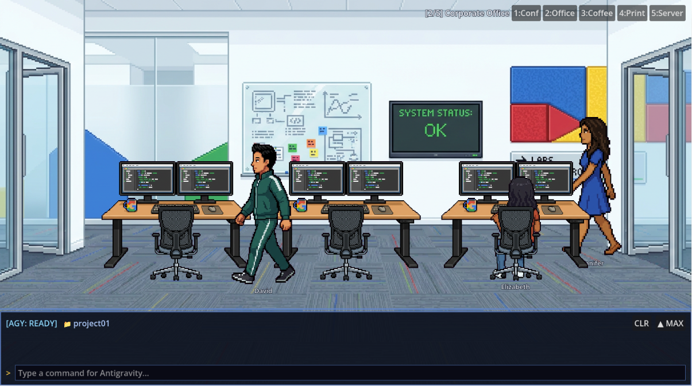
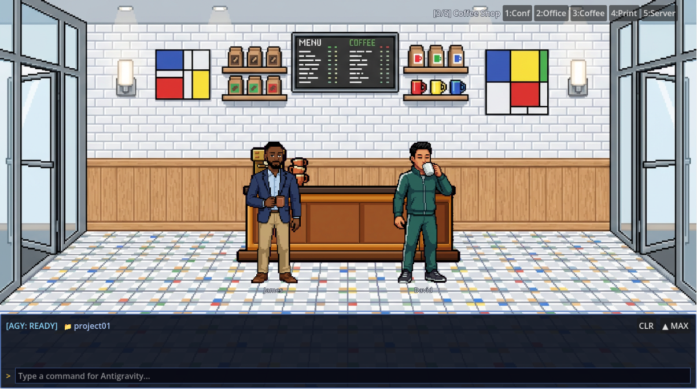
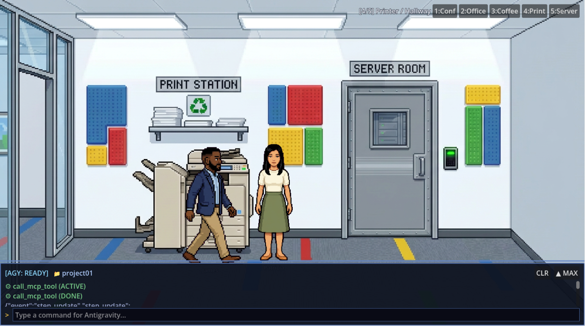
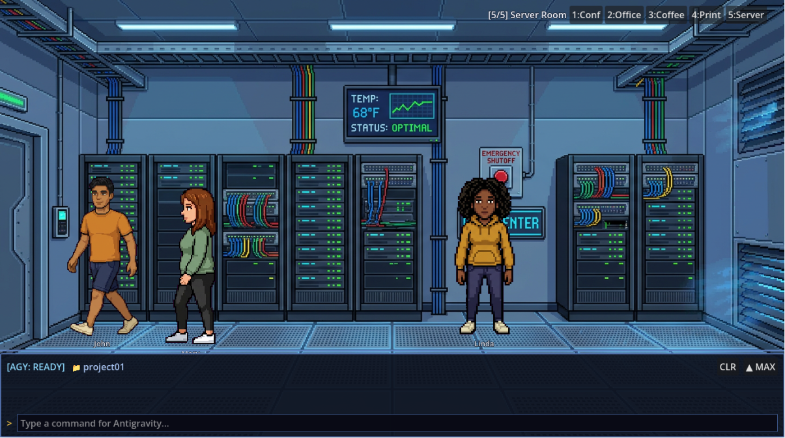

# Antigravity Office

**Antigravity Office** is a 16-bit retro pixel-art office simulation built with **Godot 4 (.NET / C#)** that brings the **Antigravity CLI (`agy`)** to life. Ten autonomous coworkers inhabit five interconnected rooms—wandering, grabbing coffee, and chatting—while live `agy` sessions direct them to sit at dual-monitor desks, type during agent turns, collaborate in the conference room when subagents spawn, and stream tool/response output in a Sierra-style terminal overlay.



## Scenes & Rooms

The office spans five interconnected rooms (`1376×768` base resolution, `Nearest` pixel-art filtering), arranged from left to right with a connecting server room off the printer hallway:

```text
[1: Conference Room] <---> [2: Corporate Office] <---> [3: Coffee Shop] <---> [4: Printer / Hallway]
                                                                                       ^
                                                                                       |
                                                                                       v
                                                                               [5: Server Room]
```

| Corporate Office (`[2/5]`) | Coffee Shop (`[3/5]`) |
| :---: | :---: |
|  |  |
| Developers walk between workstations and sit at dual-monitor desks to type when `agy` is active. | Characters take coffee breaks at the counter; this is the default starting room. |

| Printer / Hallway (`[4/5]`) | Server Room (`[5/5]`) |
| :---: | :---: |
|  |  |
| Print station and keypad-secured entrance to the server room, shown with live `call_mcp_tool` status in the console. | Server racks, cooling vents, and live status monitor (`TEMP: 68°F`, `STATUS: OPTIMAL`). |

## Key Features

- **Live Antigravity CLI Bridge (`AgyBridge.cs`)**
  - Spawns `agy --input-format stream-json --output-format stream-json` wrapped with GNU `stdbuf -i0 -oL -eL` for unbuffered real-time NDJSON streaming.
  - Parses `init`, `step_update` (`agent_response`, `tool`, `subagent_info`), and `result` events and marshals them onto Godot's main thread.
  - Cleanly terminates the entire `stdbuf`/`agy` process tree on exit.
- **Autonomous & Directed Simulation (`AgentDirector.cs`, `RoomManager.cs`, `CharacterAgent.cs`)**
  - **10-Character Roster:** `david`, `elizabeth`, `james`, `jennifer`, `john`, `linda`, `mary`, `michael`, `patricia`, and `robert`, each with 8 sprite sheets (idle, 4-direction walking, coffee drinking, seated front/back, and seated typing).
  - **BFS Room Routing & Capacity Cap:** `RoomManager` routes characters across connected `DoorPortal`s using breadth-first search while enforcing a `MaxCapacity = 3` cap per room and portal cooldowns (`2.0–4.0s`) to prevent clumping.
  - **Priority Eviction & Grace Timer:** Directed agent turns evict autonomous occupants if a room is full, sit characters at `CorporateOffice` desks (`seated_back_typing`), route subagents to secondary desks or the `ConferenceRoom`, and hold a `12s` `WAITING_INPUT` grace timer after each turn before standing characters back up.
- **Non-Distorting Sierra-Style Console (`SierraConsole.tscn` / `SierraConsole.cs`)**
  - Anchored to the bottom of a persistent `HUD` `CanvasLayer` so resizing or maximizing (`▲ MAX` / `▼ RESTORE` or dragging the top grip bar) overlays the scene without squishing or distorting the office viewport.
  - Supports command history (`Up`/`Down`), streaming agent text, color-coded tool call logs, and workspace switching without losing terminal state across rooms.

## Controls & Commands

### Navigation & Terminal Shortcuts
- **`1`–`5`** or **`Left` / `Right` Arrow** (or the top-right room buttons): Switch between rooms (when the console input is unfocused).
- **`/`** or **`Enter`**: Focus the terminal command input.
- **`Esc`**: Release focus from the terminal input so you can switch rooms.
- **`Up` / `Down` Arrow** (in console): Cycle through command history.

### Workspace Management
- **`/pwd`**: Print the current `agy` working directory in the console.
- **`/workspace <path>`**: Switch `agy` to a different project directory (supports `~` and relative paths), resetting active character leases and restarting the `agy` session in the new directory.
- **Workspace Button** (in the console header bar): Opens a folder picker dialog to switch workspaces graphically, with the last-used directory persisted to `user://settings.cfg`.

## Getting Started

### Prerequisites
- **Godot 4.7 (.NET / Mono)** (`project.godot` targets Godot `4.7` with C# / `.NET 8.0`)
- **.NET 8 SDK**
- **`agy`** (Antigravity CLI) available on `PATH` or in `~/.local/bin`
- **GNU `stdbuf`** (standard on Linux; via `coreutils` on macOS)

### Running the Application
You can launch the project from any target workspace directory using the wrapper script [`src/antigravity-office/agy-office`](src/antigravity-office/agy-office):

```bash
# Launch using the current working directory as the agy workspace
./src/antigravity-office/agy-office

# Or specify a target workspace directory
GODOT_BIN=/path/to/godot ./src/antigravity-office/agy-office /path/to/your/project
```

Alternatively, open [`src/antigravity-office/project.godot`](src/antigravity-office/project.godot) directly in the Godot (.NET) editor and run the main scene (`scenes/Main.tscn`).

### Running Tests
Unit tests for NDJSON serialization/parsing and room graph routing/capacity logic can be run with:

```bash
dotnet run --project src/antigravity-office/tests/AntigravityOffice.Tests.csproj
```

## Project Structure

```text
.
├── bin/                        # Screenshots of the running application
├── creative/                   # Raw 1376x768 room backgrounds & character/furniture sprite sheets
├── docs/                       # Architecture specification & workspace enhancement docs
└── src/antigravity-office/     # Godot 4 (.NET / C#) project
    ├── agy-office              # CLI launcher script (--workspace support)
    ├── project.godot           # Godot project configuration
    ├── assets/                 # Imported backgrounds and sprite assets
    ├── scenes/                 # Main.tscn, CharacterAgent.tscn, SierraConsole.tscn
    ├── scripts/
    │   ├── autoload/           # AgyBridge.cs, RoomManager.cs
    │   ├── simulation/         # Main.cs, AgentDirector.cs, CharacterAgent.cs, DoorPortal.cs, POIMarker.cs
    │   └── ui/                 # SierraConsole.cs
    └── tests/                  # AntigravityOffice.Tests.csproj & Program.cs
```

## Documentation
- [Architecture Specification](docs/ARCHITECTURE_SPEC.md)
- [Agy Workspace & Directory Enhancement](docs/agy-enhancement.md)
