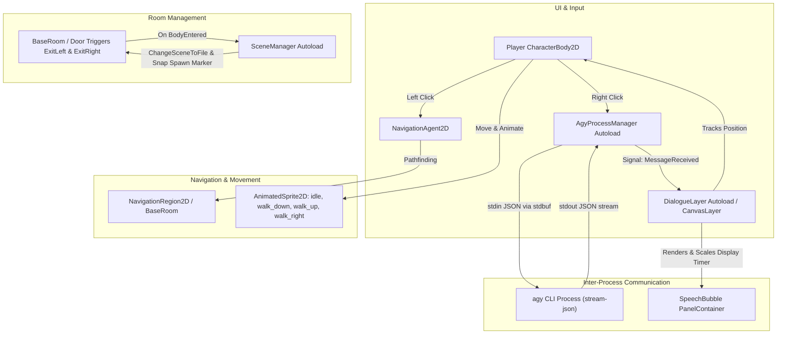
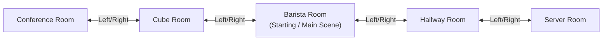

# AntigravtyOffice: Project Review & Summary

## Overview
**AntigravtyOffice** is a 2D point-and-click / top-down office exploration game built on **Godot 4.7** using **C# (.NET 8.0)**. The game enables a player character to navigate through a multi-room office layout and communicate directly with a live, background **Antigravity (`agy`) CLI** instance. Responses from the AI agent are streamed and displayed dynamically in speech bubbles hovering over the player.

---

## High-Level Architecture

---

## Room Map & Progression

The office is structured as a contiguous sequence of five interconnected rooms. Players move between them by walking into doorway collision zones (`ExitLeft` and `ExitRight` `Area2D` nodes).

| Room | Scene File | Left Connection | Right Connection | Features |
|---|---|---|---|---|
| **Conference Room** | `scenes/rooms/conference_room.tscn` | *(None / Wall)* | Cube Room (`ExitRight`) | Meeting room background, floor nav polygon |
| **Cube Room** | `scenes/rooms/cube_room.tscn` | Conference Room (`ExitLeft`) | Barista Room (`ExitRight`) | Office cubicles background |
| **Barista Room** | `scenes/rooms/barista_room.tscn` | Cube Room (`ExitLeft`) | Hallway Room (`ExitRight`) | **Main Scene** (`run/main_scene`), coffee counter |
| **Hallway Room** | `scenes/rooms/hallway_room.tscn` | Barista Room (`ExitLeft`) | Server Room (`ExitRight`) | Office corridor, angled doorway zone |
| **Server Room** | `scenes/rooms/server_room.tscn` | Hallway Room (`ExitLeft`) | *(None / Wall)* | Datacenter / server racks background |

---

## Detailed Component Breakdown

### 1. `AgyProcessManager` (`scripts/AgyProcessManager.cs`)
- **Autoload Node**: Registered in `project.godot` to initialize on game startup.
- **Process Spawning**:
  - Uses `stdbuf -i0 -oL -eL agy --input-format stream-json --output-format stream-json`.
  - Bypasses standard I/O buffering so messages can stream instantaneously between the CLI and Godot.
  - Configures UTF-8 encoding without BOM and LF line endings.
- **Protocol Handling**:
  - `init`: Handshake logged when session opens.
  - `result`: Full turn response parsed from `result.response` (or errors from `result.error`).
  - `message` / `chunk`: Streaming content chunks parsed from `content`.
  - Fallback: Non-JSON raw strings are forwarded directly.
  - Dispatches via deferred Godot signal: `MessageReceived(string text)`.
- **Process Lifecycle Management**:
  - Automatically terminates child process trees on `NotificationWMCloseRequest`, `_ExitTree`, and `AppDomain.CurrentDomain.ProcessExit`.

### 2. `DialogueLayer` (`scripts/DialogueLayer.cs` & `scenes/ui/SpeechBubble.tscn`)
- **Autoload CanvasLayer**: Manages the HUD speech bubble.
- **Dynamic Positioning**:
  - Tracks the `"player"` group in `_Process`.
  - Uses `GetGlobalTransformWithCanvas().Origin` with an offset (`-145px` vertically) to project world-space coordinates into canvas screen coordinates.
- **Adaptive Duration**:
  - Displays messages for `Mathf.Max(3.0f, message.Length * 0.06f)` seconds before automatically hiding.

### 3. `Player` (`scripts/Player.cs` & `scenes/characters/player.tscn`)
- **Node Type**: `CharacterBody2D` with `NavigationAgent2D` and `CollisionShape2D`.
- **Movement**:
  - Left-click sets target position on the 2D navigation mesh.
  - Normalizes directional velocity at `200.0f` px/sec.
- **Animations**:
  - Directional switching based on velocity vector: `walk_right` (mirrored via `FlipH` for left), `walk_down` (front), and `walk_up` (back).
  - Switches to `idle` upon reaching destination (`_navAgent.IsNavigationFinished()`).
- **Interaction**:
  - Right-click sends a test prompt (`"hello"`) to `AgyProcessManager`.

### 4. `SceneManager` (`scripts/SceneManager.cs`)
- **Autoload Node**: Handles transitions and character persistence across scenes.
- **Player Placement**:
  - Instantiates `scenes/characters/player.tscn` if not already present in the active scene.
  - Positions the player at `SpawnLeft` or `SpawnRight` marker positions depending on which door was entered.

---

## Build & Environment Status

- **Engine Version**: Godot 4.7
- **Target Framework**: .NET 8.0 (`Godot.NET.Sdk/4.7.2`)
- **Build Status**: Verified via `dotnet build` — clean compilation with 0 errors and 0 warnings.
- **External CLI Dependencies**: `agy` CLI (v1.5.5) and GNU `stdbuf`.

---

## Potential Enhancement Roadmap

1. **User Text Input Bar**:
   - Provide an in-game text field / dialogue prompt allowing the player to input custom messages and tasks for `agy`.
2. **Chunk Streaming & Dialogue Typewriter**:
   - Smooth token-by-token streaming in speech bubbles or dialogue boxes.
3. **Interactive Room Objects / Hotspots**:
   - Add clickable interactables (e.g. coffee maker in Barista Room, terminals in Server Room, whiteboard in Conference Room) with context-specific prompts for `agy`.
4. **Audio & Ambience**:
   - Background office ambience, footsteps, and chime effects for incoming messages.
